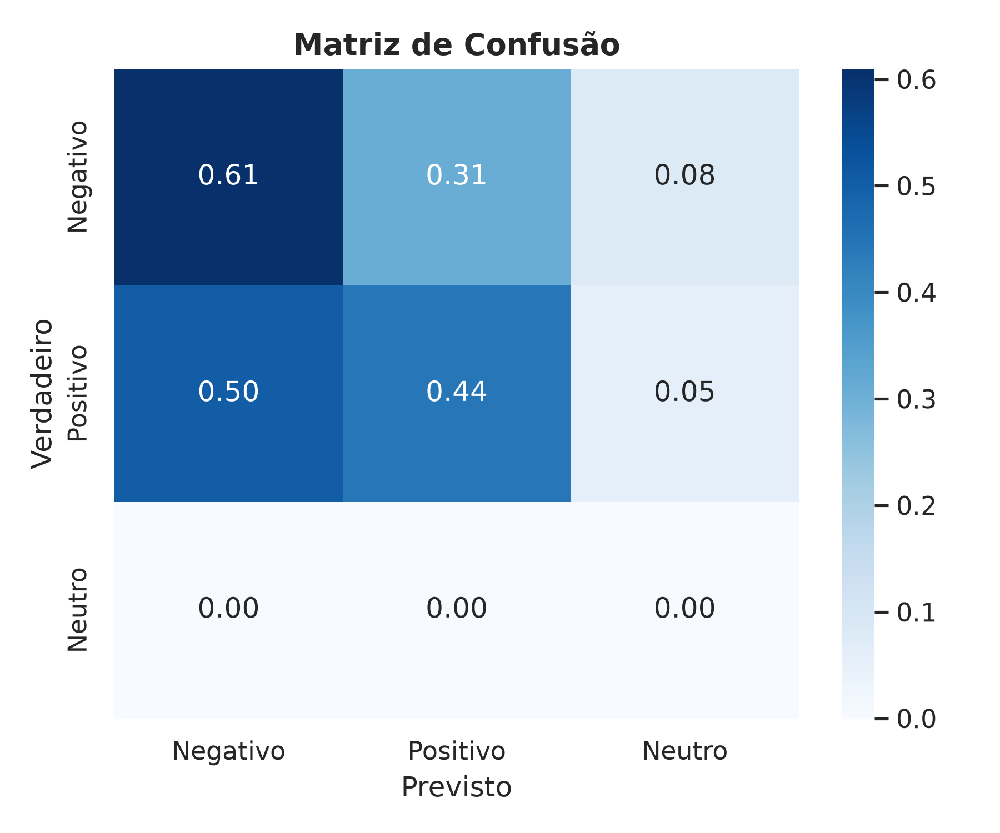
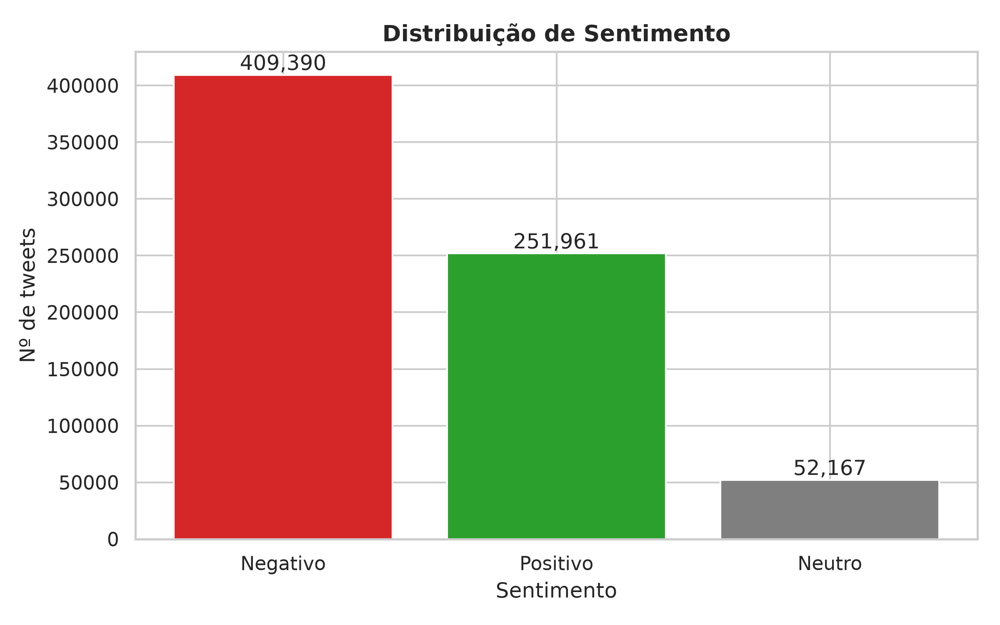

# Análise de Emoção e Tópicos em Tweets com LLM Local: Emoção e tópicos em 713 mil tweets em português, com LLM 100% local

[](https://github.com/luanfreitas5/tweets-emocao-llm-local/actions/workflows/ci.yml)
[](https://codecov.io/gh/luanfreitas5/tweets-emocao-llm-local)
[](https://luanfreitas5.github.io/tweets-emocao-llm-local/)
[](LICENSE)
 <!-- = matriz de tests.yml -->

> **Resultado:** um Transformer pré-treinado atinge **F1-macro = 0,362 (IC 95%: 0,361–0,363)** contra o rótulo de
> emoticon em 713.518 tweets — **abaixo do limiar de 0,70** definido no projeto e, nas duas classes que existem na
> referência, **acurácia de 55,3% contra 66,2% de um classificador que sempre responde "Negativo"**. O baseline
> simples (regressão logística) ainda não foi treinado. Conclusão honesta: os números servem para análise *agregada e
> exploratória*; **não** sustentam classificar tweets individuais.

## 🎯 Problema

- **Quem decide o quê:** um analista de opinião quer saber *como o público se sente* e *sobre o quê* em um grande volume
  de tweets em português, sem ler tweet por tweet e sem enviar dados a serviços externos.
- **Custo dos erros:** confundir Positivo com Negativo inverte o clima agregado (pior erro). **Métrica principal:
  F1-macro**, porque as classes têm o mesmo peso e a base é desbalanceada (66% / 34% na referência).
- **Unidade de predição:** 1 tweet limpo (sem emoticons/hashtags que denunciam o rótulo) → 1 classe + score.
- **Ideia central — Python calcula, LLM explica:** todo número vem de código determinístico; o LLM local (Ollama) recebe
  apenas o JSON já calculado ([`InsightsReport`](src/schemas/insights.py)) e o descreve em linguagem simples.

## 🗂️ Dados

| Item | Valor |
|---|---|
| Fonte e licença | [Portuguese Tweets for Sentiment Analysis](https://www.kaggle.com/datasets/augustop/portuguese-tweets-for-sentiment-analysis) — licença: ver [Datasheet](reports/datasheets/tweets_datasheet.md) (pendente) |
| Tamanho / período | `NoThemeTweets.csv`: **785.814** tweets brutos → **713.518** após a limpeza (−9,2%); coleta em 2018 |
| Alvo e prevalência | Negativo 66,2% (472.462) e Positivo 33,8% (241.056) por **supervisão distante** (emoticon). **Não há exemplos Neutro** na referência |
| Documentação | [Datasheet](reports/datasheets/tweets_datasheet.md) |

Camadas (arquitetura medalhão, nada disso vai para o Git):

```text
data/bronze/  CSVs exatamente como recebidos (imutável)
data/silver/  tweets_processed.parquet — limpo, tipado, validado com pandera
data/gold/    sentiment_predictions.parquet, topic_assignments.parquet — prontos para análise
```

## 📊 Resultados

Protocolo: **avaliação sem treino** (o modelo é pré-treinado, não foi ajustado aqui); os 713.518 tweets limpos são o
conjunto de avaliação, com o emoticon como referência (ruidosa). Seed 42; IC por bootstrap de 1.000 reamostragens.
Execução de 2026-10-24.

| Modelo | F1-macro, 3 classes (IC 95%) | F1-macro, 2 classes¹ | Acurácia |
|---|---|---|---|
| Sempre "Negativo" (referência trivial, calculada da prevalência) | 0,266 | 0,398 | 0,662 |
| Baseline: regressão logística TF-IDF | _pendente_ | _pendente_ | _pendente_ |
| `lxyuan/distilbert-base-multilingual-cased-sentiments-student` | **0,362 (0,361–0,363)** | 0,543 | 0,553 |

¹ O F1-macro de 3 classes inclui a classe Neutro, que tem **suporte 0** na referência (F1 = 0 por construção), o que
puxa o valor para baixo em 1/3. O de 2 classes é a média dos F1 de Negativo e Positivo, derivada das métricas por classe
em [`reports/metrics/classification.json`](reports/metrics/classification.json); não tem IC publicado.

| Classe | Precisão | Recall | F1 | Suporte |
|---|---|---|---|---|
| Negativo | 0,704 | 0,610 | 0,653 | 472.462 |
| Positivo | 0,423 | 0,442 | 0,432 | 241.056 |
| Neutro | 0,000 | 0,000 | 0,000 | 0 |

- **Diferença vs baseline:** não calculável sem o baseline treinado; sem ele (e um teste como McNemar) não dá para
  afirmar que o Transformer supera um modelo linear. O IC estreito (±0,001) reflete o tamanho da amostra, **não** a
  qualidade da referência.
- **Achados:** (i) a acurácia do modelo (55,3%) é **menor** que a de sempre responder "Negativo" (66,2%), embora seu F1
  nas duas classes seja maior; (ii) 50% dos positivos foram previstos como negativos; (iii) os 7,3% previstos como Neutro
  (52.167 tweets) são, por definição da referência, todos erros — a classe Neutro não pode ser validada aqui.
- **Pior segmento:** tweets curtos (1–5 palavras), F1-macro 0,334, contra 0,366 (6–15) e 0,374 (16+); a diferença é
  pequena. Ver [Model Card](reports/model_cards/sentiment_model_card.md).
- **Regressão de métrica:** `min_f1_macro: 0.70` em `configs/model_params.yaml` **não é atendido** (0,362; ou 0,543 com 2
  classes).



### Sentimento previsto e tópicos

Sentimento previsto nos 713.518 tweets: **Negativo 57,4%, Positivo 35,3%, Neutro 7,3%** (referência: 66,2% / 33,8% /
0%) — o modelo subestima Negativo e inventa Neutro.



Tópicos (BERTopic, 31 tópicos + *outliers*): a modelagem é **degenerada** — 37,9% dos tweets (270.279) caíram em
*outliers* (`topic_id = -1`) e 60,7% (432.803) em um único tópico 0, ou seja, **98,5% dos tweets não receberam um tópico
informativo**; os outros 30 tópicos somam 10.436 tweets (1,5%). O tópico 1 (4.135 tweets) é 99,9% positivo e o tópico 9
(195 tweets) o mais negativo entre os dez maiores (86,2%). Os termos principais saíram vazios (`top_terms: []`), então
os rótulos são "tópico N". O resumo do LLM (`reports/summary.md`, `llama3.1:8b`, 1 min 59 s) repete esses números e não
sinaliza o problema — leia-o junto com o JSON.

## 🔁 Reproduzir

Requisitos: [uv](https://docs.astral.sh/uv/), `make`, a base do Kaggle em `data/bronze/NoThemeTweets.csv` (download manual;
não é redistribuída aqui) e, para o resumo, o [Ollama](https://ollama.com/) com `ollama pull llama3.1:8b`. Tempos medidos na
execução de 2026-10-24: avaliação com bootstrap 9 s, figuras 4 s, resumo no Ollama 1 min 59 s; o tempo de
`preprocess`/`classify`/`topics` não foi registrado nos logs (pendente).

```bash
git clone https://github.com/luanfreitas5/tweets-emocao-llm-local.git
cd tweets-emocao-llm-local
```

<!-- verify:start -->
```bash
uv sync --locked
make smoke
```
<!-- verify:end -->

Depois de colocar os dados em `data/bronze/`:

```bash
make sample      # amostra de 5.000 tweets: preprocess → classify → evaluate → plot (sem LLM, sem tópicos)
make pipeline    # fluxo completo, incluindo tópicos e resumo via Ollama
make mlflow      # fluxo completo registrando o run no MLflow (exige árvore Git limpa)
make api         # API local em http://127.0.0.1:8000/docs
make help        # todos os alvos
```

Os números de **Resultados** vêm de [`reports/metrics/classification.json`](reports/metrics/classification.json), de
`reports/insights.json` (regenerado a cada execução, não versionado) e das figuras em `reports/figures/`, geradas em
2026-10-24 sobre a base completa (Linux/WSL, Python 3.13, `llama3.1:8b`). A execução não foi rastreada no MLflow, então
não há `git_sha` associado a esses números; rode `make mlflow` para um run com linhagem.

### Rastreamento de experimentos (MLflow)

Cada run registra tags `git_sha`, `data_hash` e `seed`, os parâmetros dos modelos, o F1-macro com IC 95% e os artefatos.
O backend é SQLite (`sqlite:///mlruns/mlflow.db`), nunca o *file store*. UI: `make mlflow-ui`.

### Docker

```bash
cp .env.example .env            # defina OLLAMA_VERSION
make docker-build && make docker-up
```

A imagem contém só código e dependências travadas (`uv sync --locked`), roda como usuário sem privilégios e **não** embute
o modelo: os pesos ficam no volume `hf_cache`. Tamanho da imagem: pendente de medição (`docker images`); o torch do
`uv.lock` vem do índice CUDA.

### API

| Endpoint | Função |
|---|---|
| `POST /sentiment` | classifica textos (mesma limpeza do pipeline; limites em `configs/deploy.yaml`) |
| `POST /summary` | resume um `InsightsReport` via Ollama |
| `GET /health` | processo ativo e se o modelo está carregado |
| `GET /version` | versão da API, modelos e SHA do commit |

## 🧱 Estrutura

```text
configs/      YAML validado por Pydantic (config, paths, logging, model_params, llm, deploy)
data/         bronze → silver → gold (fora do Git)
src/
  preprocessing/ limpeza + anti-leakage       models/      classificador, embeddings, BERTopic
  evaluation/    F1-macro com IC e por fatia   experiment/  MLflow (linhagem + métricas)
  analysis/      InsightsReport                llm/         Ollama, prompts, summarizer
  pipelines/     etapas e fluxo ponta a ponta  schemas/     contratos pandera + Pydantic
app/          API FastAPI (lifespan, /sentiment, /summary, /health, /version)
reports/      figures/, metrics/, model_cards/, datasheets/
tests/        unitários, property-based, API (TestClient) e smoke
```

Decisões que importam: **anti-*leakage*** (emoticons/hashtags que geram o rótulo são removidos do texto antes de
classificar — [`remove_label_leakage`](src/preprocessing/cleaning.py)); **contratos de dados** com `pandera` nas
fronteiras entre camadas; **logging** único configurado no ponto de entrada (`configs/logging.yaml`); **LGPD**: base
pública, processamento local, sem `@menções`/links nos relatórios.

## ⚠️ Limitações

- O rótulo de referência vem de emoticons: é ruidoso (ironia, sarcasmo) e a base é enviesada para quem usa emoticons.
- Modelo abaixo do limiar do projeto (F1-macro 0,362 < 0,70) e com acurácia inferior à de sempre prever "Negativo";
  sem baseline treinado nem teste de significância — não afirmar superioridade do modelo.
- O F1-macro de 3 classes é deprimido pela classe Neutro, que não existe na referência; a métrica deveria usar só as
  classes com suporte (hoje isso só aparece na nota de rodapé, derivado).
- Classe Neutro não validada; calibração do *score* não avaliada; fatias só por comprimento do tweet.
- Modelagem de tópicos degenerada (98,5% dos tweets em *outliers* ou no tópico 0).
- Dados de 2018; vocabulário posterior não está representado.
- O resumo do LLM é restrito por prompt, mas não é determinístico; confira-o contra `reports/insights.json`.
- Os termos dos tópicos saíram vazios na execução publicada.
- Referência e dados são de 2018 e só incluem Negativo e Positivo; sem anotação humana.

## 📄 Licença e citação

MIT — ver [LICENSE](LICENSE) © 2026 Luan Freitas. Documentação: [Model Card](reports/model_cards/sentiment_model_card.md)
· [Datasheet](reports/datasheets/tweets_datasheet.md).
